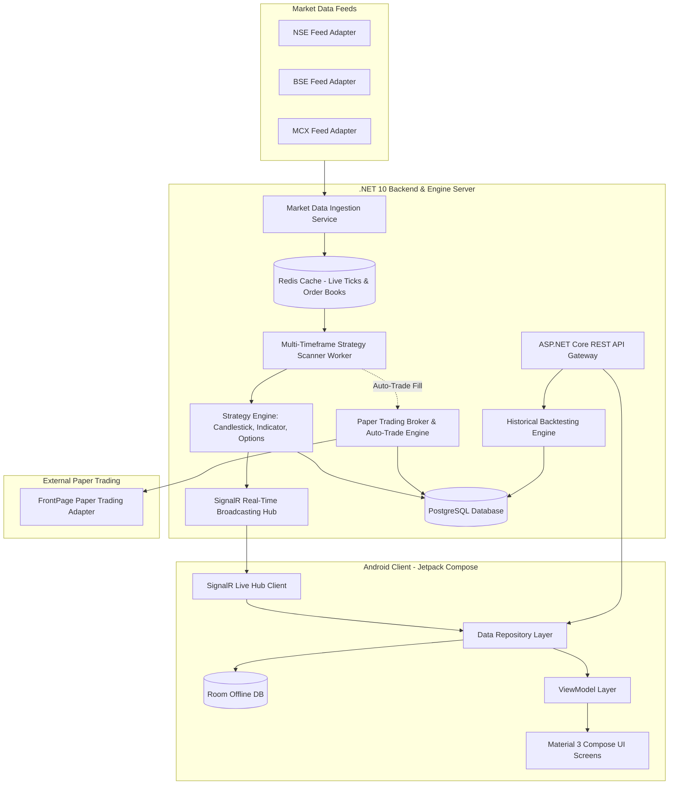
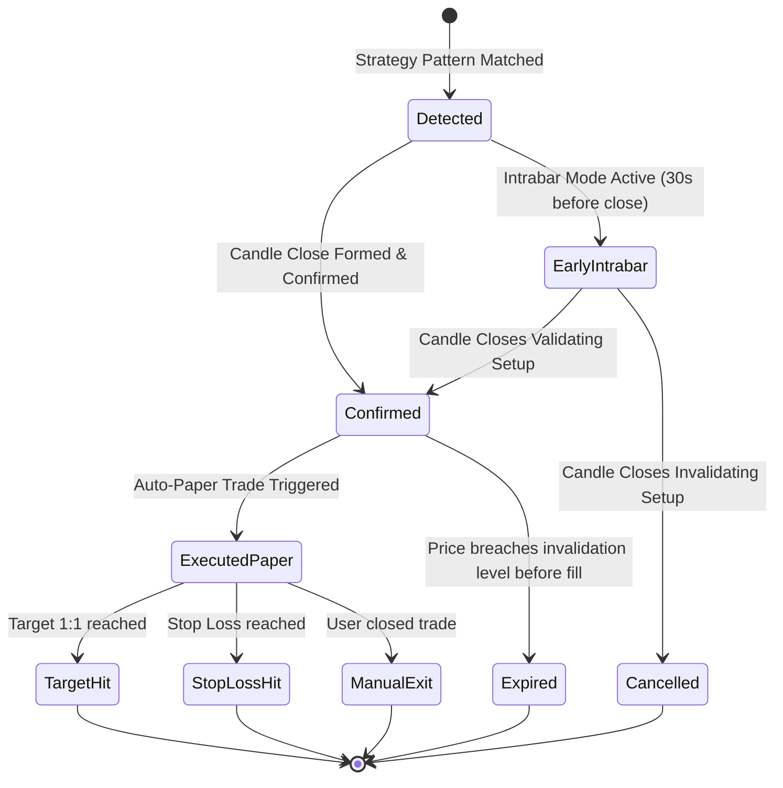
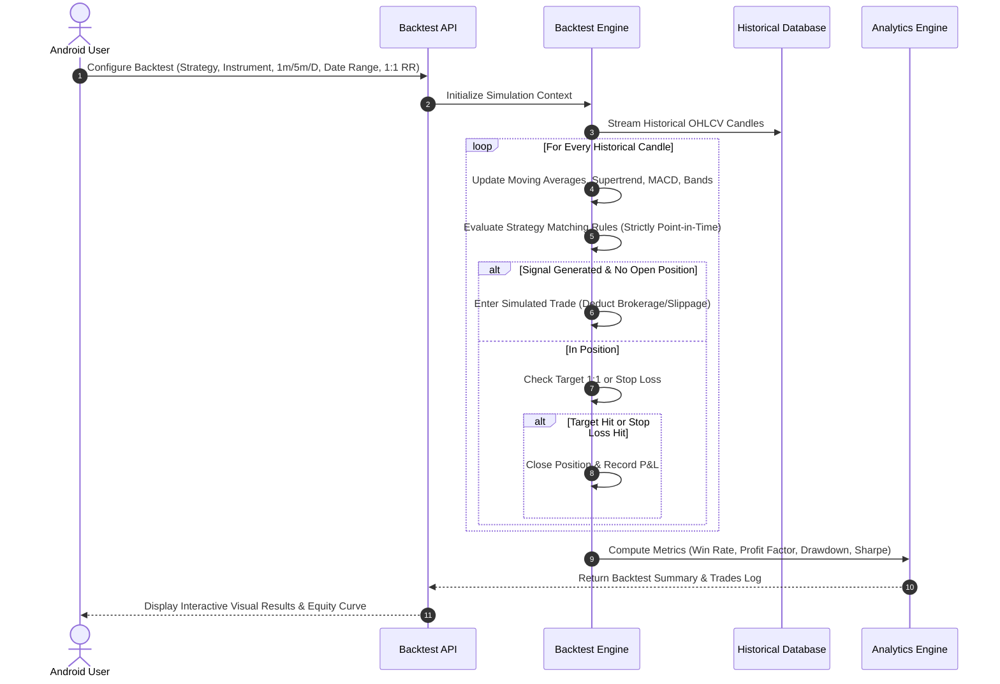

# ALL ROUNDER AI – PHASE 2: SYSTEM ARCHITECTURE SPECIFICATION

**Document Version:** 1.0.0  
**Project Name:** ALL ROUNDER AI – Stock Market Strategy Scanner & Automated Paper Trading Platform  
**Target Runtime:** Android 8.0+ (API 26+) Client / ASP.NET Core (.NET 10) Server  
**Architecture Style:** Modular Clean Architecture (Client) + Micro-Service / Modular Monolith (Backend)  

---

## 1. System Architecture Overview

The system is split into two robust, independent, yet tightly synchronized components:
1. **ALL ROUNDER AI Mobile Terminal (Android):** Kotlin, Jetpack Compose, Material 3, MVVM + Clean Architecture, Room local database, Retrofit/OkHttp, and SignalR Client.
2. **ALL ROUNDER AI Backend & Scanner Engine:** ASP.NET Core Web API (.NET 10), PostgreSQL database, Redis distributed cache, SignalR real-time hubs, and Background Hosted Scanner Services.



---

## 2. Component Design & Clean Architecture

### 2.1 Android Client Clean Architecture
```
com.allrounder.ai/
├── app/                  # Application class, Hilt dependency injection modules
├── core/
│   ├── common/           # Result wrapper, AppConstants, Extensions, TimeUtils
│   ├── network/          # Retrofit clients, SignalR manager, Interceptors, Auth
│   ├── database/         # Room Database, DAOs, Entity definitions, Converters
│   └── designsystem/     # Theme, Color, Typography, Custom Compose Components
├── domain/
│   ├── model/            # Domain models (Instrument, Candle, Signal, Strategy, Order)
│   ├── repository/       # Repository interfaces
│   └── usecase/          # Pure business logic UseCases (ScanMarket, RunBacktest, etc.)
└── presentation/
    ├── home/             # Home Dashboard screen & ViewModel
    ├── scanner/          # NSE/BSE/MCX/F&O Scanner screen & ViewModel
    ├── signals/          # Live Buy/Sell signals & Detailed Analysis screen
    ├── chart/            # Interactive TradingView-style candlestick chart screen
    ├── backtest/         # Backtesting dashboard & results screen
    ├── options/          # Option Chain & Strategy Builder screen
    └── papertrading/     # FrontPage paper trading & portfolio screen
```

### 2.2 Backend (.NET 10) Clean Architecture
```
AllRounderAi/
├── src/
│   ├── AllRounderAi.Domain/         # Core Domain Entities, Enums, Value Objects
│   ├── AllRounderAi.Application/    # Interfaces, DTOs, Business Logic, MediatR
│   ├── AllRounderAi.Infrastructure/ # EF Core, PostgreSQL, Redis, Feed Adapters, FrontPage
│   ├── AllRounderAi.Engine/         # Strategy Algorithms, Indicators, Scanner, Backtester
│   └── AllRounderAi.WebApi/         # Controllers, SignalR Hubs, Background Workers
└── tests/
    ├── AllRounderAi.Tests.Unit/     # Strategy engine mathematical unit tests
    └── AllRounderAi.Tests.Backtest/ # Historical backtesting verification tests
```

---

## 3. Signal Lifecycle & State Machine

Every signal identified by the Scanner passes through a deterministic state machine:



---

## 4. Market Scanner & Ingestion Architecture

### Separate Scopes: Cash vs F&O
1. **Cash Market Scanner:**
   - Evaluates all NIFTY 500, BSE 500, Small/Mid-cap liquid instruments.
   - Filters: Minimum turnover (INR 5 Cr/day), Volume > 100k, Spread < 0.15%.
   - Candlestick body rule configured in percentage ($0.2\% \text{ to } 0.8\%$).
2. **F&O Market Scanner:**
   - Evaluates NIFTY, BANK NIFTY, FINNIFTY, MIDCPNIFTY, and ~180 F&O stock futures.
   - Evaluates Option strikes (ATM $\pm$ 5 strikes) with high Open Interest.
   - Strict 7–10 point rule applied for NIFTY / BANK NIFTY indices.
   - Applies Protective Put / Protective Call strategies based on macro trend and OI buildup.

---

## 5. FrontPage Paper Trading Integration Architecture

FrontPage is India's leading paper trading and community platform.
To ensure robustness without violating terms or brittle automations:
- **Adapter Interface (`IPaperTradingProvider`):** Standard broker contract.
- **Provider Implementations:**
  1. `FrontPageApiProvider`: Connects via user-authorized session tokens or Webhook API if provisioned.
  2. `InternalSimulatedBroker`: Ultra-high performance zero-latency simulated broker providing identical order book matching, slippage, and brokerage calculation.
- **Auto-Trade Safeguards:**
  - Idempotency keys generated per signal ($ID = \text{SignalId} + \text{Timestamp}$).
  - Maximum daily risk limit (default 2% of paper capital).
  - Maximum concurrent open positions (default 5 positions).
  - No duplicate orders per instrument in the same direction.

---

## 6. Historical Backtesting Architecture



---

## 7. Security, Reliability & Compliance
- **No Real Capital Risk:** Built strictly as a simulated paper trading and technical analysis decision-support tool.
- **Timezone Synchronization:** All timestamps normalized to `Asia/Kolkata` (IST, UTC+5:30).
- **Exchange Holidays:** Dedicated Indian market calendar database table preventing false scanning signals on holidays or outside trading hours (09:15 to 15:30 IST).
